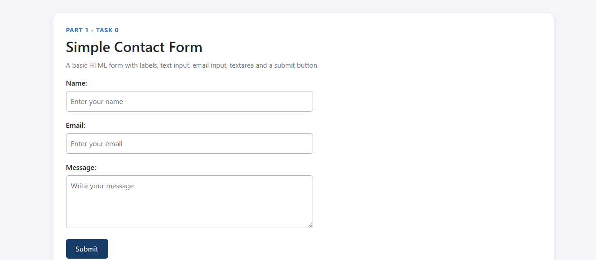
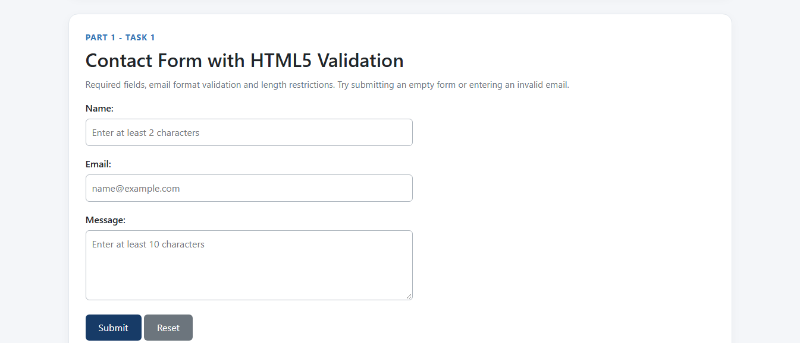
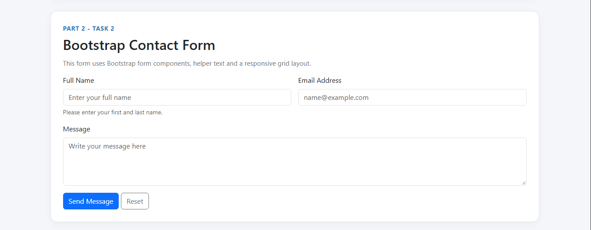
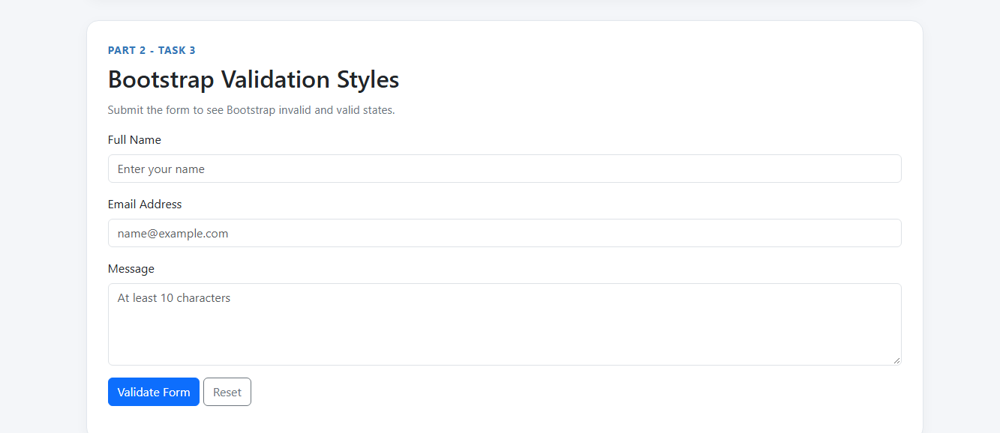
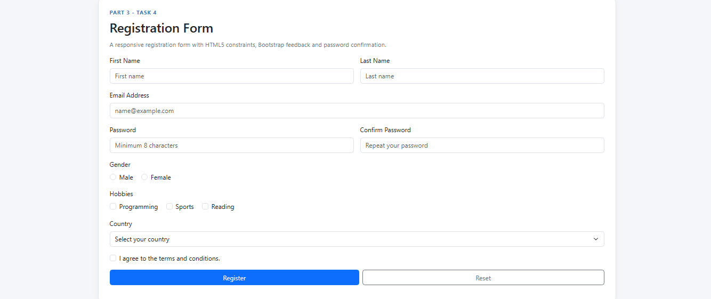

# Web Technologies Assignment 4: Forms and Validation

**Student Name:** Said Sana Ullah Sadat
**Group:** IT 2502

## Project Overview

This project demonstrates HTML forms, HTML5 validation, Bootstrap styling, and responsive registration forms. All five tasks are organized on one webpage.

## Task 0: Simple Contact Form

Created a contact form containing Name, Email, Message, and Submit fields with appropriate labels.

## Task 1: HTML5 Form Validation

Used HTML5 validation attributes such as `required`, `type="email"`, and `maxlength` to validate user input.

## Task 2: Bootstrap Form Styling

Used Bootstrap 5.3.3 to style a contact form with a responsive layout, placeholders, and helper text.

## Task 3: Bootstrap Validation Styles

Used Bootstrap classes such as `is-valid` and `is-invalid`, together with feedback messages.

## Task 4: Responsive Registration Form

Created a registration form containing first name, last name, email, password, password confirmation, gender, hobbies, and country fields.

## Technologies Used

* HTML5
* CSS3
* JavaScript
* Bootstrap 5.3.3

## Conclusion

This assignment helped me practice creating forms, validating user input, styling forms with Bootstrap, and building responsive web interfaces.

All five tasks are included in `index.html`. Screenshots for each task are stored in the `screenshots` folder.
